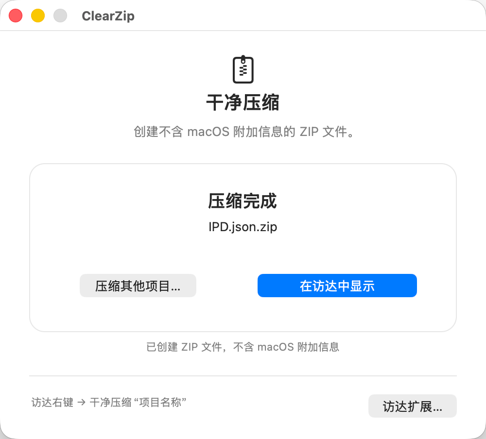
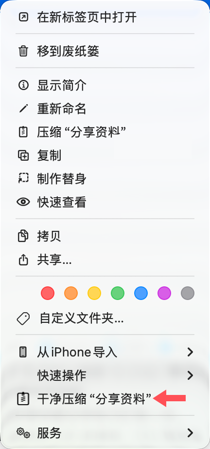

<div align="center">

<h1>ClearZip</h1>

<p><strong>原生 macOS ZIP 工具 · Finder 右键 · 去除系统附加元数据</strong></p>

<p>macOS 压缩包可能夹带 <code>.DS_Store</code>、<code>._*</code> 等 Finder 杂项。ClearZip 自动过滤，让分享、交付和上传的 ZIP 更清爽。</p>

<p><a href="https://github.com/LJjayyy/ClearZip/releases/latest"><strong>下载 v1.0.0</strong></a>　·　<a href="https://github.com/LJjayyy/ClearZip">查看源码</a></p>

<p><sub>macOS 13+ · Apple Silicon</sub></p>

</div>

<table width="100%">
<tr>
<td width="66%"></td>
<td width="34%"></td>
</tr>
<tr>
<td align="center"><sub>真实应用界面 · 压缩完成</sub></td>
<td align="center"><sub>真实 Finder 右键菜单 · 箭头指向 ClearZip</sub></td>
</tr>
</table>

<table width="100%">
<tr>
<th align="center">跨平台协作</th>
<th align="center">项目交付</th>
<th align="center">团队共享</th>
</tr>
<tr>
<td align="center">设计素材发给 Windows 同事</td>
<td align="center">资料包发客户或上传网盘</td>
<td align="center">分享代码与素材 ZIP</td>
</tr>
</table>

## 三步，得到干净 ZIP

1. 打开 DMG，将 ClearZip 拖到“应用程序”。
2. 打开一次，在“访达扩展…”中启用 ClearZip。
3. 在访达选中文件，右键点 **干净压缩“项目名称”**。

ZIP 会安静地生成在原目录；压缩成功后不会弹出 ClearZip 窗口。

## 只清理 Mac 痕迹

| 移除 | 保留 |
|:--|:--|
| `.DS_Store`、`._*`、`__MACOSX` | `.env` 等普通隐藏文件、中文文件名、空文件夹 |
| 资源分叉、扩展属性、ACL、隔离标记 | 符号链接本身、文件结构、权限与修改时间 |

“干净”指 ZIP 不携带 macOS 附加元数据，不会清除文件内容里的 EXIF 或 Office 作者信息。

## 首次打开

应用使用 ad hoc 签名，未进行 Apple 公证。首次打开若被 macOS 拦截，请按[苹果说明](https://support.apple.com/zh-cn/102445)在“隐私与安全性”中允许打开。

<details>
<summary>开发者：从源码构建</summary>

需要 macOS 13+、Xcode Command Line Tools 与 Python 3。构建架构与本机一致。

```sh
bash Scripts/build.sh
bash Scripts/test.sh
bash Scripts/package-dmg.sh
```

代码与原创图标采用 [MIT 许可证](LICENSE)。更多开发说明见 [CONTRIBUTING](CONTRIBUTING.md)。

</details>
